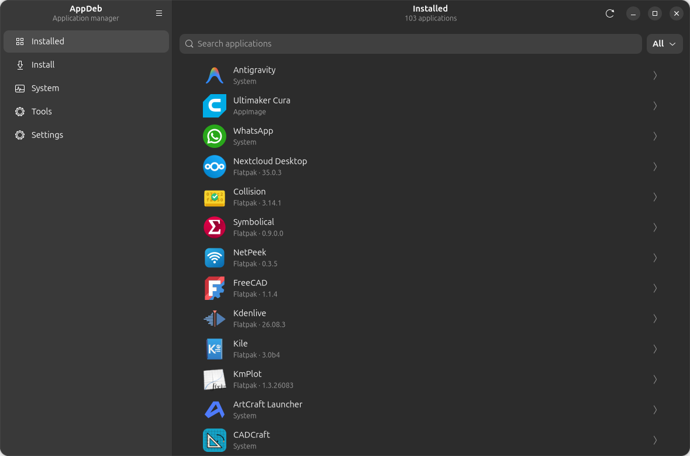
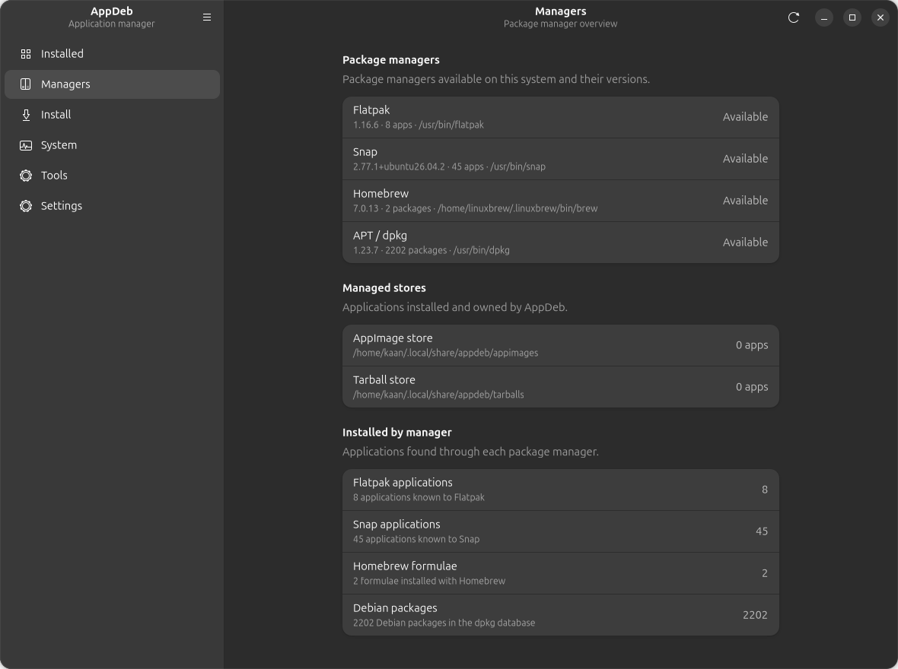
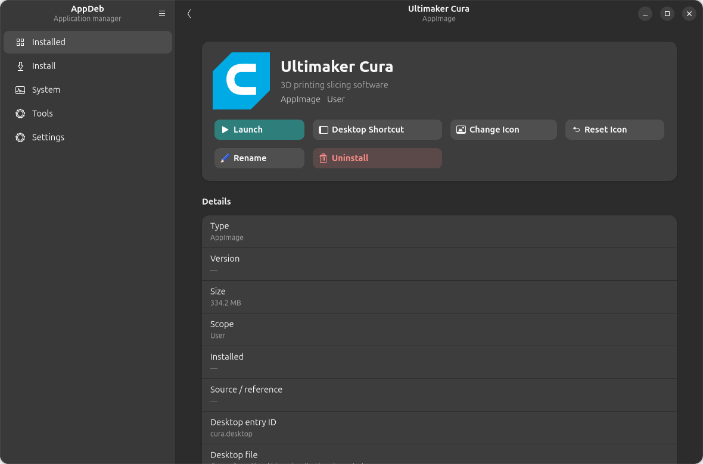
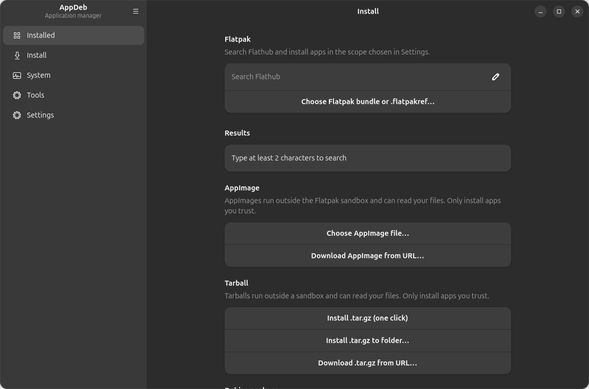

# AppDeb

**Full-control installer and manager for Flatpak, Snap, Homebrew, AppImage, `.deb` and portable `.tar.gz` applications on Debian-based Linux — with store details, screenshots and desktop-entry icon repair.**

[](https://github.com/ta4anx/appdeb/actions/workflows/ci.yml)
[](https://github.com/ta4anx/appdeb/releases)
[](LICENSE)

Every packaging format on the Linux desktop leaves a different gap. Flatpak apps hide their
files and permissions behind commands. AppImages arrive as loose files with no menu entry.
Local `.deb` files need `apt` and produce no trace in a GUI. Tarballs need manual unpacking,
a hand-written `.desktop` file and an icon import. And when an app's menu entry does not
declare its window class, the running window shows a generic gear icon instead of the real
logo.

AppDeb puts all four formats in one window and adds the missing pieces: a details page per
application (size, version, scope, executable, files, live resources), menu name and icon
editing, desktop shortcuts, Flatpak update/permission management, autostart toggles, and a
desktop-entry doctor that repairs broken or icon-less entries.





## Features

**Install**

- Flatpak: search Flathub (and other configured remotes) inside the app, install with one
  click, or install a local `.flatpak` / `.flatpakref` bundle.
- AppImage: pick a file or download from an `https://` URL, with optional SHA-256 check.
  Name, comment, categories, window class and icon are pre-filled from the bundle's own
  metadata; the bundle is copied into a managed store.
- `.tar.gz` / `.tgz`: one-click install with auto-detected executable, icon and metadata into
  `~/.local/share/appdeb/tarballs/<slug>/`, a second flow that installs into a folder you
  pick, and a URL flow. Ambiguous archives get an explicit executable/name/icon dialog.
- `.deb`: inspect package, version, architecture, installed size and dependencies before
  installing through polkit.
- Snap: search the Snap Store or type a snap name and install it; system installs go through
  polkit.
- Homebrew: search formulae or type the formula name and install it, with an upgrade action
  for outdated formulae. Brew installs stay in your user account.

**Manage**

- Installed list with search and kind filters and a Flatpak update badge for update-all.
- Details per app: kind, version, size, scope, install date, source, desktop ID, desktop file,
  `Exec` line, live CPU / RSS / threads / process count / disk I/O / start time, end-processes
  button, and every relevant path (bundle, install dir, Flatpak location, `~/.var/app/<id>`,
  config/data/cache dirs) with a folder button.
- Rename menu entries (locale variants cleaned up, original name preserved), change icons
  (imported into your user hicolor theme), create and remove desktop shortcuts, reset an icon.
- Window-class editor: set `StartupWMClass` so a running window is associated with its menu
  entry and the dock shows the real icon instead of the gear.
- Flatpak permissions: network, IPC, Wayland, X11, audio, home and host-filesystem toggles
  via user overrides, raw permission text, reset-all.
- Autostart switch per application (XDG autostart).
- AppImage replace-in-place and tarball replace/reinstall, both keeping the desktop entry.
- `.deb` removal with dependency-impact listing and a hard refusal for essential or
  desktop-critical packages.
- Store details per app: description, developer, license, homepage and store screenshots
  (Flathub AppStream, Snap Store media) loaded in the background, with a full-size viewer.
- Change the package manager: AppDeb searches the other managers for the same app (for
  example Ultimaker Cura's AppImage has a Flatpak and a Snap build) and installs it there;
  you then decide whether to remove the previous copy.
- Application parameters: edit the menu comment, categories, keywords and `Exec` line, toggle
  terminal mode or hiding the entry from the application menu (user override, never the vendor
  file), switch a Snap's channel, refresh a Snap, hold Snap refreshes, and hold an apt package
  version — plus Flatpak permission overrides.
- Managers page: which package managers exist on the machine, their versions, install
  locations, and how many packages each one manages, plus the AppDeb-managed AppImage and
  tarball stores.

**Diagnose**

- Desktop doctor scan: invalid entries, duplicate `[Desktop Entry]` groups, missing icons,
  absolute-path icons, missing executables, and windows whose class is not associated with
  any entry. Each fix is backed up first.
- System page: CPU (with sparkline), memory, swap, home disk, network rates, load average,
  uptime and the top five processes, refreshed every two seconds.

**Command line**

- `appdeb list`, `appdeb managers`, `appdeb search`, `appdeb install` (files or
  `--from brew|snap|flatpak`), `appdeb remove`, `appdeb scan`, `appdeb fix-icons` for
  scripted use and headless machines.

## Install

Download the latest `.deb` from the [releases page](https://github.com/ta4anx/appdeb/releases)
and install it:

```bash
wget https://github.com/ta4anx/appdeb/releases/latest/download/appdeb_0.3.0_all.deb
sudo apt install ./appdeb_0.3.0_all.deb
appdeb
```

Requirements (installed automatically as package dependencies): Python 3.10+, PyGObject,
GTK 4.10+, libadwaita 1.4+, `python3-psutil`, `python3-requests`, `python3-pil`,
`desktop-file-utils`, `pkexec`, `flatpak`, `gtk-update-icon-cache`. Recommended:
`squashfs-tools` (AppImage metadata extraction), `xdg-utils`, `appstream`.

Build from source:

```bash
git clone https://github.com/ta4anx/appdeb.git
cd appdeb
bash scripts/build_deb.sh      # produces build/appdeb_<version>_all.deb
```

Run without installing (from the clone):

```bash
python3 -m appdeb
```

## Usage

### GUI

| Page | What it does |
| --- | --- |
| **Installed** | Every desktop application, with kind filter and search; Flatpak updates appear as a button |
| **Managers** | Flatpak, Snap, Homebrew and APT availability, versions, paths and package counts |
| **Install** | Flatpak and Snap search, Homebrew formulae search and typed install, AppImage file/URL, tarball one-click / to-folder / URL, `.deb` inspection |
| **System** | CPU, memory, swap, disk, network, load, uptime, top processes |
| **Tools** | Desktop doctor scan/fix, icon cache rebuild, application database refresh, entry backup |
| **Settings** | Flatpak scope for installs, hidden entries, refresh interval, About |





### CLI

```bash
appdeb list                                   # desktop id, name, kind, version
appdeb list --json
appdeb managers                              # which managers exist, versions, package counts
appdeb search ripgrep                        # Flatpak + Snap + Homebrew results
appdeb install ripgrep --from brew           # typed install through Homebrew
appdeb install gnome-calculator --from snap
appdeb install ./Foo.AppImage --name Foo --icon foo.png
appdeb install ./Foo.deb
appdeb install ./Foo.tar.gz                   # one-click into ~/.local/share/appdeb/tarballs
appdeb install ./Foo.tar.gz --dest ~/Apps     # choose the destination folder
appdeb install ./Foo.tar.gz --exec Foo-1.0/bin/foo
appdeb remove appdeb-foo.desktop --yes
appdeb scan                                   # doctor findings, one per line
appdeb fix-icons                              # apply every fixable finding
appdeb --version
```

`appdeb` with no subcommand opens the GUI; passing a file opens the matching install flow.

## Permissions and safety

- Flatpak installs use the **user** installation by default; switching to system scope prompts
  through polkit. A system install that reports an authorization failure is retried once with
  `pkexec`.
- AppImages and tarballs run **outside** any sandbox and can read your files. AppDeb shows this
  warning in every flow; only install software you trust.
- Homebrew installs into your user account and needs no privilege escalation; Snap and `.deb`
  operations are system-wide and prompt through polkit.
- Store metadata and screenshots are fetched over https from Flathub and the Snap Store and
  cached under `~/.cache/appdeb/`; AppDeb still works offline (offline AppStream data, cached
  JSON, or no store details at all).
- `.tar.gz` extraction rejects absolute paths, `..` traversal, device/FIFO members, escaping
  symlinks and hardlinks, archives with more than 20 000 members, and archives expanding past
  4 GiB. Installation is atomic: a failed extract never leaves a half-populated directory.
- `.deb` removal refuses essential packages and packages whose removal would take out
  `ubuntu-desktop`, `gnome-shell`, `gdm3`, `systemd`, `apt` or `dpkg`, and shows the full
  dependency impact before asking for confirmation.
- Menu, icon and window-class edits are written to `~/.local/share/applications` only — system
  and Flatpak entries are never modified in place.
- Doctor fixes and duplicate-group repairs back up the affected desktop entries (and the AppDeb
  database) under `~/.local/share/appdeb/backups/` first.
- Uninstalling an AppImage or tarball removes only the copy AppDeb manages; the file or archive
  you downloaded is never touched.

## Development

```text
appdeb/            Python package (GTK4 + libadwaita)
  backends/        flatpak, snap, brew, appimage, tarball, deb adapters + process runner
  storemeta.py     Flathub / Snap Store details, screenshots and caching
  sources.py       finds the same app in other package managers
  services/        downloader, autostart
  ui/              application, window, pages, widgets, dialogs
data/              io.github.ta4anx.AppDeb.desktop, AppStream metainfo, app icon
tests/             unittest suites (no network, no user state)
scripts/           launcher, .deb builder
.github/workflows/ CI and tag-driven release
```

```bash
python3 -m appdeb                                  # run from the source tree
python3 -m unittest discover -s tests -v           # tests
bash scripts/build_deb.sh                          # build the .deb
```

Tests isolate `HOME`, `XDG_DATA_HOME`, `XDG_CONFIG_HOME` and `XDG_CACHE_HOME` into temporary
directories, so running them never modifies your real menu entries.

## License

GPL-3.0-or-later. See [LICENSE](LICENSE).
