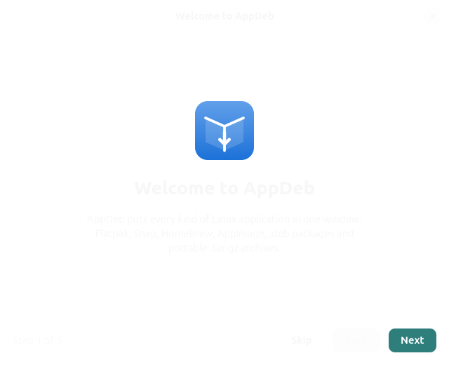
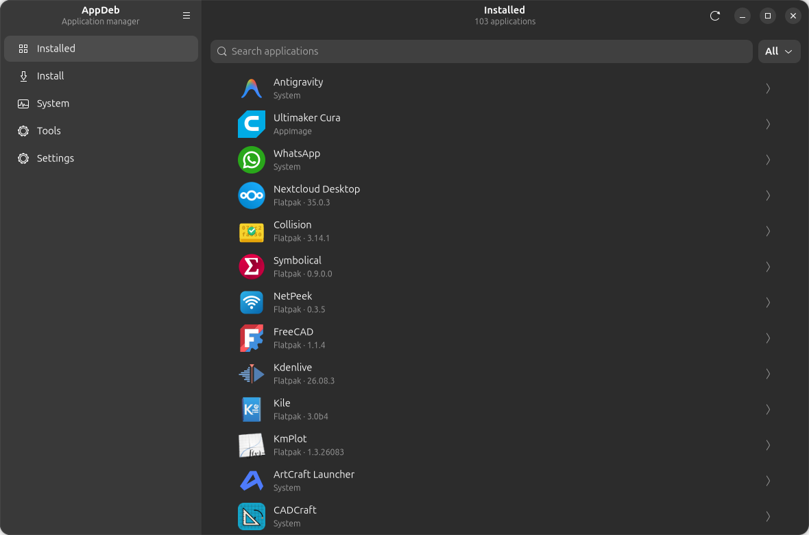

# First launch

The first time you open AppDeb it shows a short welcome guide. You can replay it later from
**Settings → Getting started → Show welcome guide**.

## The welcome guide, page by page

1. **Welcome to AppDeb** — what the app is for. Click **Next**.
2. **Check your package managers** — AppDeb looks at what your system already has (Flatpak,
   Snap, Homebrew, APT). Click **Next**.
3. **Install by searching or by typing** — you can install by name or from a downloaded file.
   Click **Next**.
4. **Fix icons and desktop entries** — the Tools page repairs broken menu entries. Click
   **Next**.
5. **You are ready** — click **Finish**.

You can click **Skip** at any time; the guide will not bother you again. If you want it back,
open **Settings → Getting started → Show welcome guide**.

## The window

- **Left sidebar** — the six pages:
  | Page | Use it for |
  | --- | --- |
  | **Installed** | Everything on the computer, with search and sorting |
  | **Managers** | Which package managers exist, and their package counts |
  | **Install** | Installing new apps by search, by name, or from a file/URL |
  | **System** | CPU, memory, disk, network and the busiest processes |
  | **Tools** | The desktop-entry doctor, icon cache, backups |
  | **Settings** | Flatpak scope, language, hidden entries, welcome guide |
- **Top bar** — the page title and its buttons (for example, the refresh button on
  **Installed**).
- **Content** — the page itself.

## Choose your language first

If English is not your language:

1. Click **Settings** in the sidebar.
2. Find the **Language** group and open the dropdown.
3. Pick your language: Türkçe, Deutsch, Français, 中文（简体）, Español, 한국어, Polski,
   Svenska, Italiano, Azərbaycanca or Dansk.
4. A toast appears: **Restart AppDeb to apply**. Click **Restart** (or close and reopen the
   app).

The interface switches immediately after the restart. To go back to English, choose
**English** in the same list — it stays available at all times.

More details: [Languages](Languages.md).

## Two settings worth checking now

Both are on the **Settings** page.

- **Installation scope** (Flatpak group) — **User** installs apps only for your account, no
  administrator password needed. **System** installs them for everyone and asks for your
  password. Keep **User** unless you know you want otherwise.
- **Show hidden desktop entries** — off by default. Leave it off: hidden entries are usually
  helpers, not apps.

## What the coloured dots and the gear mean

- An app in the **Installed** list is not running; AppDeb lists everything installed, not only
  what is open.
- If an app shows a **grey gear** in the dock or application menu, its menu entry is missing a
  window-class association. [Fixing icons](Fixing-Icons.md) explains the two-click repair.

Next: [Installing apps](Installing-Apps.md)
