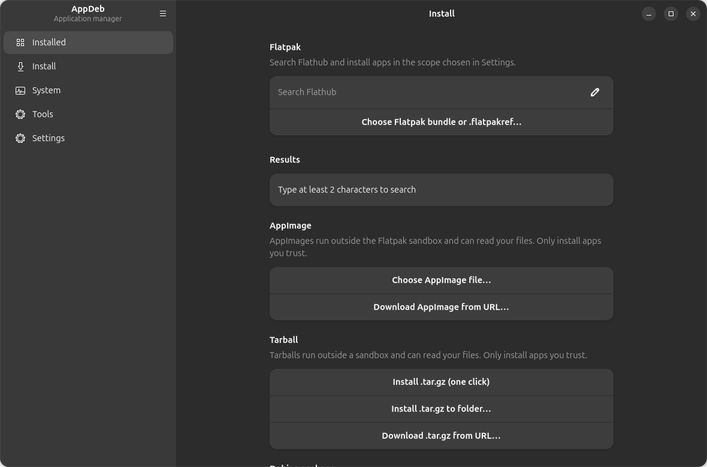

# Installing apps

Open the **Install** page in the sidebar. It has four groups, one per kind of application.
Read the one you need.

> **A warning that applies to everything on this page:** apps you install from a file
> (AppImage, `.tar.gz`) are **not sandboxed** — they can read your files, just like a normal
> program. Only install software from a source you trust. Flatpak, Snap, Homebrew and `.deb`
> packages are installed by your system's package managers, which is safer.

---

## 1. Install a Flatpak app

Flatpak is the easiest and safest way to install desktop apps on Ubuntu.

1. Click **Install** in the sidebar.
2. In the **Flatpak** group, click the search field and type at least **2 characters** of the
   app name, for example `calculator`.
3. Press Enter or wait a moment. Results appear below with name, app ID and description.
4. Click **Install** on the row you want.
5. A window appears with a progress bar and the raw output. When it closes, the app is
   installed and appears under **Installed**.

Useful to know:

- Installations go to your **user** installation by default, so no password is needed. If you
  switched **Settings → Installation scope** to **System**, a password prompt appears.
- The search covers Flathub and any other remote you have added to Flatpak.
- To install a **Flatpak bundle** someone sent you (`.flatpak` or `.flatpakref`), use
  **Choose Flatpak bundle…** in the same group.

---

## 2. Install a Snap app

1. On **Install**, find the **Snap** group.
2. Search for a name (`gnome-calculator`, for example) or type the exact snap name into
   **Install snap by name** and press the **Install** button next to it.
3. Snap installs are system-wide, so AppDeb asks for authentication. Wait for the progress
   window to finish.

Tip: the **Install snap by name** field works even when search finds nothing — useful when you
already know the exact name from <https://snapcraft.io>.

---

## 3. Install a Homebrew formula

Homebrew installs command-line tools into your home folder; no password is needed.

1. On **Install**, find the **Homebrew** group.
2. Search (`ripgrep`) or type the exact formula name in **Install formula by name** and click
   **Install**.
3. When the progress window closes, the tool is installed. Homebrew programs usually do not
   create menu entries; use them from a terminal.

The **Upgrade outdated formulae** button updates everything Homebrew has marked as outdated.

---

## 4. Install an AppImage

An AppImage is a single file that runs on many distributions. AppDeb copies it into a managed
folder and creates a proper menu entry with an icon for you.

1. Download an `.AppImage` file with your browser.
2. On **Install**, click **Choose AppImage file…** and pick the file.
   - AppDeb reads the app's own metadata: name, comment, categories, window class and icon.
   - If the bundle has no icon, the dialog says "No embedded icon found" — click
     **Choose…** and pick a PNG or SVG, or **Extract icon** when one is available.
3. Check the fields. You can change the name (that is what appears in the menu), the comment,
   the categories and the window class.
4. Click **Install**.

What happens next: the file is copied to `~/.local/share/appdeb/appimages/<name>/` and a menu
entry `appdeb-<name>.desktop` is created. The menu entry has a **Replace AppImage…** button
later, so you can update the bundle without losing the name or icon.

You can also install from a link:

1. Click **Download AppImage from URL…**.
2. Paste an `https://` link, optionally paste the SHA-256 checksum from the download page, and
   click **Download**. The same install dialog opens afterwards.

---

## 5. Install a `.deb` package

1. On **Install**, click **Choose .deb package…**.
2. AppDeb inspects the file and shows the package name, version, architecture, installed size,
   dependencies and description.
3. Click **Install**. A password prompt appears (system packages need administrator rights).
4. When it finishes the app appears under **Installed**.

`.deb` packages are part of the system, so AppDeb warns you that installing one changes
system files. Uninstalling is on the app's details page.

---

## 6. Install a `.tar.gz` / `.tgz` application

Portable tarballs are common for apps that are not packaged for Linux. AppDeb does the manual
work for you: unpack, find the program, copy the icon, write the menu entry.

**One-click (recommended)**

1. On **Install**, click **Install .tar.gz (one click)**.
2. Pick the archive.
3. AppDeb detects the program to run, the icon and the name, unpacks the archive into
   `~/.local/share/appdeb/tarballs/<name>/`, and adds a menu entry. On success you land on the
   new app's details page.

**Install into a folder you choose**

1. Click **Install .tar.gz to folder…**.
2. Pick the destination folder, then the archive.
3. AppDeb installs into `<folder>/<name>/`. Everything else is the same.

**If AppDeb cannot find the program to run**

Some archives have several executables or none in the usual place. In that case a settings
dialog opens:

- choose the **Executable** from the list (or pick the archive again after unpacking),
- adjust the **Name** and the **Icon**,
- keep or change the **Destination**.

**From a URL**

Click **Download .tar.gz from URL…**, paste an `https://` link (checksum optional) and choose
whether to install in the managed folder or into a folder you pick.

**To update later:** open the app's details page and use **Reinstall/Replace archive…**. The
old copy is kept as a backup next to the new one.

---

## Where do installed apps appear?

Immediately under **Installed**, with their real icon. If a menu entry does not appear in your
desktop's application menu right away, log out and back in, or run
`update-desktop-database ~/.local/share/applications` in a terminal.

Next: [Managing apps](Managing-Apps.md)
