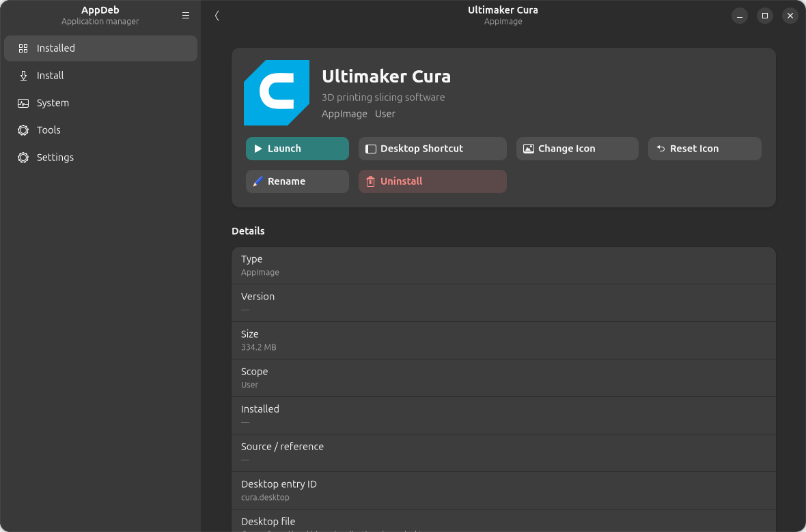

# Managing apps

Everything here starts on the **Installed** page: click an app to open its details.

## Finding an app in the list

- **Search** — type part of the name or the app ID in the search box at the top.
- **Filter** — the **All** dropdown limits the list to Flatpak, AppImage, Tarball, Snap or
  System apps.
- **Sort** — the **Sort by** dropdown orders the list by:
  - **Name (A–Z)** / **Name (Z–A)**
  - **Kind** (AppImage, Flatpak, Snap …)
  - **Size (largest first)**
  - **Version**
  - **Recently installed (newest first)**

  Your choice is remembered the next time you open AppDeb.

## The details page

At the top you see the big icon, the name, the comment, and badges for the kind, the scope
(user or system) and the version. Under them are six buttons:

| Button | What it does |
| --- | --- |
| **Launch** | Starts the app |
| **Desktop Shortcut** | Puts a clickable shortcut on your desktop (click again to remove it) |
| **Change Icon** | Replaces the icon everywhere (menu, dock, window) |
| **Reset Icon** | Restores the icon that was there before |
| **Rename** | Changes the name shown in the menu (the original is preserved) |
| **Uninstall** | Removes the app — always asks first |

### Rename an app

1. Click **Rename**.
2. Type the new name and press **Rename**.
3. The menu entry updates immediately. AppDeb keeps the original name in the file
   (`X-Appdeb-OriginalName`) so nothing is lost, and removes outdated translated name
   variants.

### Change the icon

1. Click **Change Icon**, pick a `.png` or `.svg` file.
2. AppDeb imports it into your personal icon theme (resized to 256×256 when needed) and points
   the menu entry at it.
3. If a running app still shows the old icon, close and reopen that app.

**Reset Icon** brings back the previous one.

### Desktop shortcut

Click **Desktop Shortcut**. A file with the app's name appears on your Desktop, marked
trusted so your desktop environment will run it. Click the button again to remove the
shortcut. AppDeb never deletes anything else from your Desktop.

### Dock icon association

The **Dock icon association** group shows the window class used to match the running window
with the menu entry. If the dock shows a gear instead of the real icon, see
[Fixing icons](Fixing-Icons.md). You can edit the value and press **Save**; a toast confirms
"Dock icon association updated".

### Files

The **Files** group lists every path that belongs to the app: the desktop entry, the
executable, the install folder, Flatpak's data folders, configuration and cache. Click the
folder button to open one in your file manager.

### Resources and processes

The **Resources** group updates every two seconds while the page is open: CPU, memory,
threads, number of processes, disk read/write, and when the app started. **End processes**
closes the app after a confirmation — use it when an app hangs.

### Startup

The **Startup** group has one switch: **Start at login**. Turn it on to launch the app
automatically when you sign in; turn it off to remove that behaviour.

### Application parameters

The **Application parameters** group edits the menu entry itself. Use it when an app's menu
entry is wrong or ugly, not to configure the app.

| Field | Meaning |
| --- | --- |
| **Comment** | The grey description under the name in the menu |
| **Categories** | Menu categories, separated by `;` (for example `Graphics;`) |
| **Keywords** | Extra words used by menu search |
| **Exec** | The exact command used to start the app. Change it only if you know the new path |
| **Terminal application** | Run the app in a terminal window |
| **Hide from application menu** | Keep the entry but hide it from the app grid |

Every **Save** writes to a personal override in `~/.local/share/applications` — the original
file owned by the package manager is never modified. Each change shows a toast.

### Uninstall

Click **Uninstall** and confirm. What happens depends on the kind of app:

- **Flatpak** — removed with `flatpak uninstall`.
- **AppImage** — the managed copy and the menu entry are removed. The file you downloaded
  stays where it is.
- **Tarball** — the folder AppDeb created and the menu entry are removed. The archive stays.
- **Snap** — removed with `snap remove` (password prompt).
- **`.deb`** — the Debian package group on the details page lists the package, its version,
  maintainer and dependencies. Removal shows which other packages would also be removed and
  refuses to remove essential system packages.

### Special groups by kind

- **AppImage** — current bundle path, **Replace AppImage…**, **Open bundle folder**.
- **Tarball** — install folder, executable, original archive, **Choose…** to change the
  executable, **Reinstall/Replace archive…** to update.
- **Snap** — channel dropdown, **Refresh snap now**, **Hold updates**.
- **Flatpak** — permission switches (network, IPC, Wayland, X11, audio, home folder, host
  filesystem), raw permission text, **Reset all overrides**.
- **Debian package** — package facts, **Hold package version**, purge option, **Remove…**.
- **Store details and screenshots** — description, developer, license, homepage and screenshots
  from Flathub or the Snap Store. Click a screenshot to see it full size.

Next: [Package managers](Package-Managers.md)
