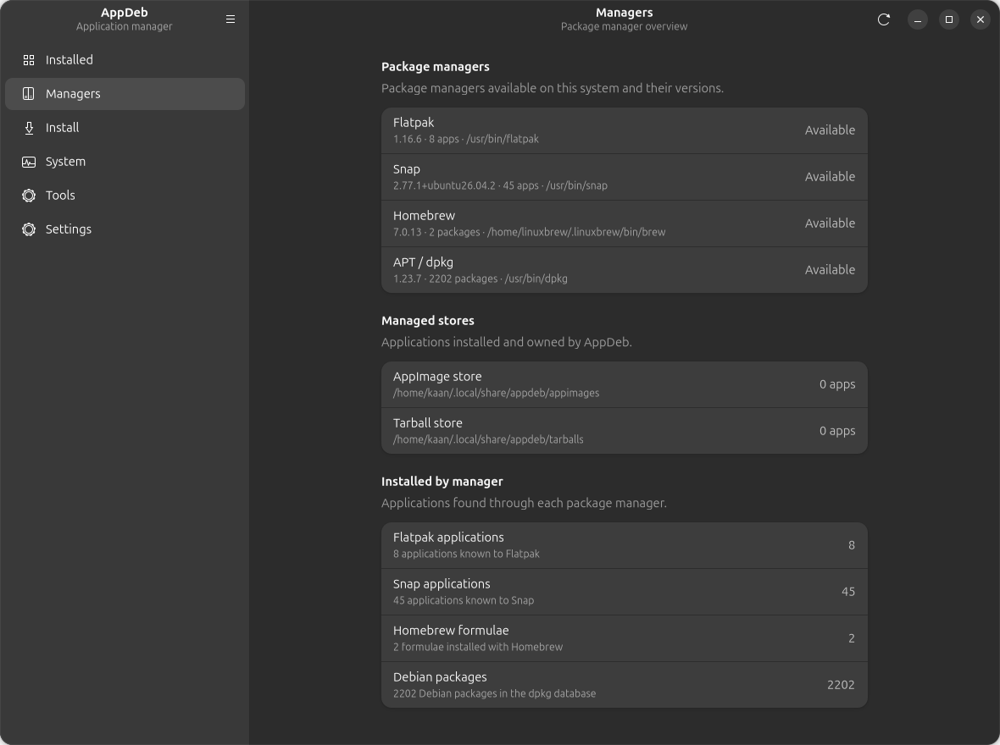

# Package managers

A *package manager* is the program that actually installs and updates software. Linux has
several; AppDeb can talk to four of them.

The **Managers** page tells you what your computer has and how much each manager owns.

## Reading the page

**Package managers** — one row per manager:

| Row | What the numbers mean |
| --- | --- |
| **Flatpak** | `1.16.6 · 8 apps · /usr/bin/flatpak` — version, Flatpak apps, binary path |
| **Snap** | same idea, for snaps |
| **Homebrew** | version, formulae installed, path to `brew` |
| **APT / dpkg** | the Debian system package manager, with the number of installed packages |

The badge on the right says **Available** or **Not installed**.

**Managed stores** — the two folders AppDeb owns:

- **AppImage store** — `~/.local/share/appdeb/appimages/`
- **Tarball store** — `~/.local/share/appdeb/tarballs/`

**Installed by manager** — counts per manager, so you can see at a glance where your apps come
from.

Press the circular arrow button in the header to refresh the numbers.

## Install a missing package manager

If a manager shows **Not installed**, its row has an **Install** button.

1. Click **Install** on the row.
2. Read the confirmation ("Install Flatpak? This uses apt and asks for authentication") and
   confirm.
3. A progress window shows the `apt-get` output.
4. When it finishes, the page refreshes and the row shows **Available**.

Flatpak and Snap can be installed this way. **APT/dpkg** is part of the base system and cannot
be installed or removed here.

## Remove a package manager

You can remove Flatpak or Snap **only when they no longer manage any packages**. This is a
safety rule: removing a manager with apps installed would leave those apps broken.

- When the manager has packages, its **Remove** button is greyed out. Hover it to read why, for
  example: *"Flatpak manages 8 packages; remove it first."*
- When the count is zero, **Remove** is active. Click it, confirm, and the package is removed
  with `apt-get remove --purge`.

**Homebrew** and **APT/dpkg** are never removed by AppDeb:

- Homebrew lives inside your home folder and is removed with its official script. AppDeb shows
  the exact command in a dialog with the instruction "This action is performed manually".
- APT/dpkg is the base system; removing it would break the operating system.

## Keep things up to date

- **Flatpak updates** — the **Installed** page shows a button like *"3 Flatpak updates"* when
  updates are available. Click it to update everything with one progress window.
- **Homebrew updates** — on **Install**, the Homebrew group has **Upgrade outdated formulae**.
- **Snap updates** — snaps update automatically. On a snap's details page you can also
  **Refresh snap now** or **Hold updates**.
- **`.deb` updates** — these belong to the system; use your normal Software Updater.

Next: [Switching package manager](Switching-Package-Manager.md)
