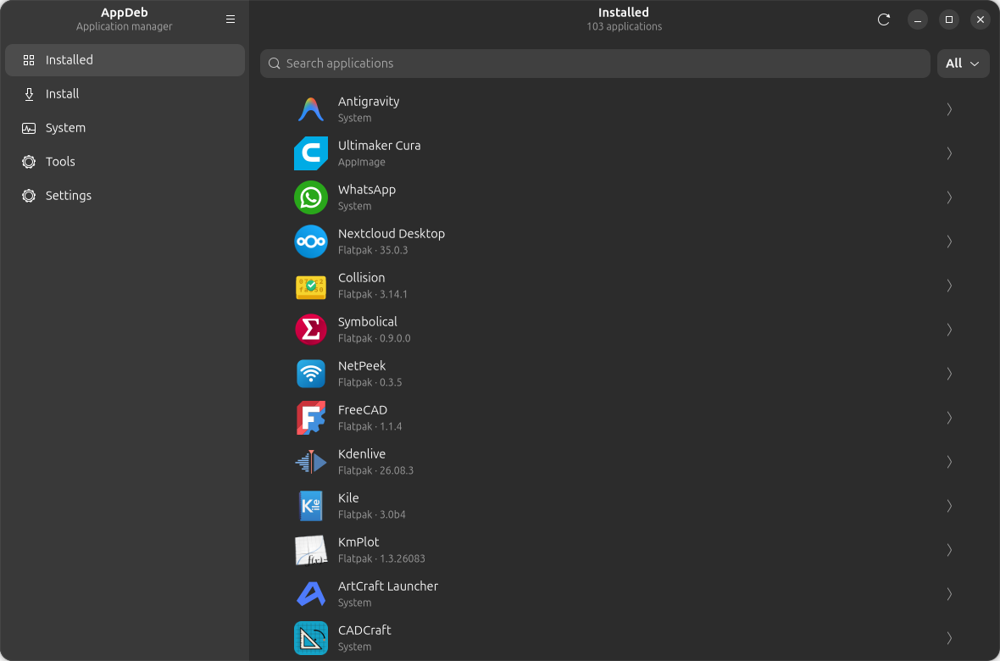

# AppDeb — Start here

Welcome! AppDeb installs, manages and tidies up applications on Linux (Ubuntu, Debian,
Linux Mint, Pop!_OS, elementary and other Debian-based distributions). It speaks your
language: **English, Türkçe, Deutsch, Français, 中文（简体）, Español, 한국어, Polski,
Svenska, Italiano, Azərbaycanca, Dansk**.

You do **not** need the terminal to use AppDeb. Everything in this guide can be done with
the mouse, except the last chapter, which is optional for people who like scripts.

## What can AppDeb do?

- Install apps from **Flatpak**, **Snap** and **Homebrew** by searching or typing a name.
- Install a file you downloaded: **`.AppImage`**, **`.deb`**, **`.tar.gz`** or a Flatpak
  bundle — or a download link for those files.
- Show every installed app in one list, with its real icon, size, version and files.
- Rename an app's menu entry, change its icon, and put a shortcut on your desktop.
- Fix the annoying **grey gear icon** that some apps show in the dock.
- Show how much **CPU, memory and disk** an app uses right now, and let you close it.
- Show **screenshots and descriptions** from the app store inside the app.
- Switch an app to another package manager when an equivalent exists.
- Install or remove the package managers themselves, update Flatpak and Homebrew apps.
- Start an app automatically when you log in (autostart).

## The guide in order

1. [Installation](Installation.md) — how to install AppDeb and start it.
2. [First launch](First-Launch.md) — the welcome guide, language, and the window layout.
3. [Installing apps](Installing-Apps.md) — Flatpak, Snap, Homebrew, AppImage, `.deb`, `.tar.gz`.
4. [Managing apps](Managing-Apps.md) — details, icons, names, shortcuts, parameters, uninstall.
5. [Package managers](Package-Managers.md) — see what is installed, install or remove a manager.
6. [Switching package manager](Switching-Package-Manager.md) — keep the app, change who owns it.
7. [Fixing icons](Fixing-Icons.md) — the grey gear icon and the desktop-entry doctor.
8. [System and resources](System-and-Resources.md) — CPU, memory, disk, network, processes.
9. [Languages](Languages.md) — how to change the interface language.
10. [Command line](Command-Line.md) — the optional `appdeb` commands.
11. [Troubleshooting](Troubleshooting.md) — when something does not work.
12. [FAQ and glossary](FAQ-and-Glossary.md) — plain-language explanations of the jargon.

> Every page starts from the assumption that you have never used this app before.
> If a sentence uses a technical word, the [glossary](FAQ-and-Glossary.md#glossary) explains it.

## The five-second version

1. Install AppDeb (see [Installation](Installation.md)).
2. Open **AppDeb** from your application menu.
3. Click **Install** in the sidebar, choose **Flatpak**, type an app name, click **Install**.
4. To manage something, click **Installed**, then the app.
5. If an icon looks wrong, open **Tools → Scan desktop entries → Fix**.

## Getting help

- Open an issue: <https://github.com/ta4anx/appdeb/issues>
- Check [Troubleshooting](Troubleshooting.md) first; it covers the common cases.
